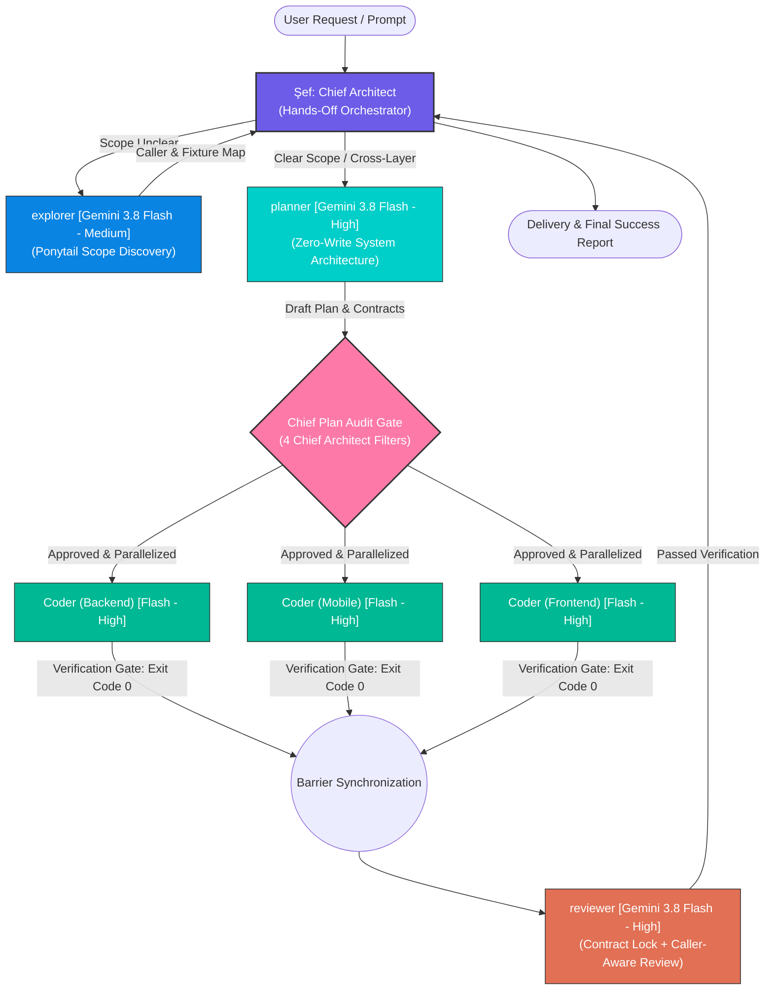

# ⚡ ecc-lite-orchestrator

> 🌐 **Language / Dil:** **[🇬🇧 English](README.md)** | [🇹🇷 Türkçe](README.tr.md)

[](https://opensource.org/licenses/MIT)
[](#-agent-matrix--roles)
[](#-agent-matrix--roles)
[](#-0-token-os-shields--progressive-memory)
[](#-triple-platform-support)

---

## 🌐 Overview

**`ecc-lite-orchestrator`** is an enterprise-grade multi-agent engineering framework that transforms AI-assisted software development from hit-or-miss prompt experiments into a deterministic, surgical, and production-tested engineering discipline.

Designed for modern IDEs and autonomous development environments, the framework operates through a **Hands-Off Chief Architect** coordinating **4 Universal Subagents (`explorer`, `planner`, `coder`, `reviewer`)** exclusively running on **Gemini 3.8 Flash** (High & Medium Effort modes). Instead of exhausting the LLM context window with raw code files, `ecc-lite-orchestrator` fuses the proven core principles of 5 prominent open-source paradigms into a single, cohesive developer stack.

---

## 🧬 Architectural Philosophy (5-Repo Synthesis)

`ecc-lite-orchestrator` synthesizes the strongest insights of the open-source agentic engineering community while deliberately rejecting bloated or destructive patterns:

| # | Paradigm & Source | Primary Principles & Core Implementation |
|:---:|---|---|
| **1** | **[obra/superpowers](https://github.com/obra/superpowers)** | **Systematic Debugging & Verification Gate:** Speculative patches and symptom guessing are strictly prohibited. Root causes must be isolated and proven before fixes are made. **"NO COMPLETION CLAIMS WITHOUT FRESH VERIFICATION EVIDENCE"** (exit code 0 terminal proof required). |
| **2** | **[DietrichGebert/ponytail](https://github.com/DietrichGebert/ponytail)** | **Ponytail Minimalism, YAGNI & Debt Ledger:** Ruthlessly prune one-off abstractions, redundant factories, and bloated dependencies. Intentional shortcuts are explicitly tracked via `// shortcut: <limit>, <trigger>` in a structured debt ledger. Includes **Ponytail Scope Discovery**. |
| **3** | **[multica-ai/andrej-karpathy-skills](https://github.com/multica-ai/andrej-karpathy-skills)** | **Surgical Diffs & Low Cognitive Load:** Edits are restricted strictly to the lines essential for the task. Adjacent blocks, comments, and existing styling remain untouched, eliminating diff noise and regressions. |
| **4** | **[thedotmack/claude-mem](https://github.com/thedotmack/claude-mem)** | **2-Stage Progressive Search:** Never dump dozens of documentation files into context. Query a lightweight topic index first (`search_knowledge_index`), then retrieve only targeted detail sections (`get_knowledge_detail`), slashing token burn. |
| **5** | **[ecc-lite](https://github.com/muhammeteminozturk/ecc-lite)** | **0-Token OS Shields:** Execute pre-tool parameter validations and secret scanning via local bash hooks (`secret-guard.sh`, `verify-quiet.sh`) at OS speed with zero model token consumption. |

### 🚫 Deliberately Rejected Patterns

To maintain peak reasoning quality and operational stability, two popular community practices were explicitly rejected:

1. **`caveman` (Extreme Token Compression / Grammar Butchery):**  
   Compressing agent output into broken, caveman-style telegraphic language degrades the underlying model's chain-of-thought depth, semantic precision, and architectural reasoning. We achieve superior token economy through **Ponytail Minimalism** and **2-Stage Progressive Memory Retrieval**, preserving pristine technical communication.
2. **`claude-mem` Background Daemon:**  
   Persistent background daemons introduce socket leaks, runaway memory footprints, zombie processes, and hidden CPU/token polling. `ecc-lite-orchestrator` replaces this with an on-demand, stateless Python standard-library MCP server (`ecc-lite-brain`) that wakes up only when queried.

---

## 🖥️ Triple-Platform Support

`ecc-lite-orchestrator` natively equips three major AI developer platforms through a single unified installation:

```
┌────────────────────────────────────────────────────────────────────────┐
│                        ecc-lite-orchestrator                           │
│               Core Plugins, 10 Skills, 0-Token Shields                 │
└──────────────┬─────────────────────────┬───────────────────────────────┘
               │                         │
      ┌────────▼────────┐       ┌────────▼────────┐       ┌──────────────▼────────┐
      │   Antigravity   │       │   Claude Code   │       │      Cursor IDE       │
      │   (Gemini CLI)  │       │      (CLI)      │       │     (Global / Proj)   │
      └────────┬────────┘       └────────┬────────┘       └──────────────┬────────┘
               │                         │                               │
  • ~/.gemini/config/plugins/   • ~/.agents/                     • ~/.cursor/mcp.json
  • ~/.gemini/config/           • ~/.claude/agents/              • ~/.cursor/rules/*.mdc
    mcp_config.json             • ~/.claude/skills/              • ~/.cursor/skills/
                                • ~/.claude/rules                • ~/.cursor/agents/
                                                                 • <project>/.cursor/
```

### 1. Google Antigravity
* Full plugin registry located in `~/.gemini/config/plugins/ecc-lite` and `~/.gemini/config/plugins/orchestration`.
* MCP registration in `~/.gemini/config/mcp_config.json` running `ecc-lite-brain`.

### 2. Claude Code CLI
* Standardized symlinks mapped into `~/.agents/` (`hooks`, `kb`, `mcp`, `rules`, `skills`).
* Agent definitions linked into `~/.claude/agents/` and skill packages into `~/.claude/skills/`.

### 3. Cursor IDE (Global & Project-Specific)
* MCP server registered in `~/.cursor/mcp.json`.
* Rule sets synced as Cursor MDC rules in `~/.cursor/rules/*.mdc`.
* Global agents and skills in `~/.cursor/agents/` and `~/.cursor/skills/`.
* Dedicated project-level configuration via `./install.sh --cursor-project <path>`.

---

## 🏛️ Agent Matrix & Roles

The system is governed by **1 Hands-Off Chief Architect** and **4 Universal Subagents**. All subagents strictly run on **Gemini 3.8 Flash** to maximize speed, logical comprehension, and cost efficiency.



### Agent Roster & Permissions

| Agent | Model & Effort | Primary Mission | Tool Permissions |
|---|---|---|:---:|
| **Şef (Chief Architect)** | Top Orchestrator Model (e.g. Gemini 4 Argon) | Understands intent, performs triage, enforces audit gates, coordinates subagents. | **Coordinator Only:** Zero code writing (`write_to_file`, `replace_file_content`), zero terminal execution, zero raw source reading. |
| **`explorer`** | Gemini 3.8 Flash *(Medium Effort)* | **Ponytail Scope Discovery:** Maps callers, dependencies, fixtures, configs; produces a crisp summary (max 150 words). | Read-Only |
| **`planner`** | Gemini 3.8 Flash *(High Effort)* | Absorbs raw source files in an isolated context; outputs a 40–80 line architectural plan with locked DTO/DB contracts. | Read-Only |
| **`coder`** | Gemini 3.8 Flash *(High Effort)* | Spawned as N parallel roles (`Coder (Backend)`, `Coder (Mobile)`, etc.); performs surgical edits and runs the Verification Gate. | Write & Execute |
| **`reviewer`** | Gemini 3.8 Flash *(High Effort)* | Two-Stage Audit: 1) Strict Contract Adherence, 2) Ponytail Caller-Aware deep review, security, and N+1 query scans. | Read-Only |

---

## 🛡️ Chief Architect Plan Audit Gate (4 Filters)

When `planner` submits a draft plan, the Chief Architect **never blindly relays it** to the user or coder agents. The plan must pass through the **4 Chief Architect Audit Filters**:

1. **Ponytail Minimalism & YAGNI Pruning:** Strip superfluous database tables, one-off factory classes, unused endpoints, speculative abstractions, and unnecessary external dependencies.
2. **Cross-Layer Contract & Nullability Lock:** Ensure endpoint URLs, HTTP verbs, payload keys, casing conventions, data types, and nullability match 100% across Backend, Mobile, and Web Admin.
3. **Karpathy Scope & Assumptions Check:** Verify that no unrelated neighboring files are touched and eliminate unverified assumptions that require user clarification.
4. **Authorization & Data Safety:** Enforce proper authorization (AuthZ) guards, data integrity, non-destructive migrations, and backward compatibility.

> [!IMPORTANT]
> If any bloat or flaw is detected, the Chief either sends an immediate refinement request via `send_message` or prunes the plan directly. Only the audited and locked plan is delivered to developers.

---

## 🚦 Smart Triage: Fast Bypass vs. Full Orchestration

```
                      Is scope already clear?
                             │
              ┌──────────────┴──────────────┐
             YES                            NO
              │                             │
    Does change affect              Spawn explorer
     <= 2 files with                (Ponytail Scope Discovery)
    0 contract changes?                     │
      │              │              Does discovery show
     YES             NO             <= 2 files & 0 contracts?
      │              │                      │
      │              │            ┌─────────┴─────────┐
      │              │           YES                  NO
      ▼              ▼            │                   │
  [ FAST          [ FULL          ▼                   ▼
   BYPASS ]      ORCHESTRATION] [ FAST             [ FULL
  1x Coder        Planner        BYPASS ]         ORCHESTRATION]
  directly        required      1x Coder           Feed scope
                                directly           to Planner
```

* **Fast Bypass:** For localized tasks (`<= 2` files, 0 contract/schema modifications, bug fixes, UI tweaks), planning bureaucracy is completely bypassed. The Chief directly delegates to `1x coder`, who implements the fix and provides fresh verification evidence.
* **Full Orchestration:** For multi-layer features, schema updates, or changes spanning `> 2` files, the full pipeline (`explorer` → `planner` → Chief Audit Gate → Parallel `coder`s → `reviewer`) is strictly enforced.

---

## ⚖️ Concurrency vs. Sequentiality Matrix

To prevent race conditions, context waste, and merge conflicts, subagent transitions adhere to strict execution rules:

| Transition / Phase | Allowed Mode | Rationale & Architectural Rule |
|---|:---:|---|
| **`explorer` ↔ `planner`** | ⛔ **STRICTLY SEQUENTIAL** | **Never parallel!** If spawned concurrently, `planner` cannot leverage the discovery map, wasting tokens on redundant searches and breaking Fast Bypass triage. |
| **`planner` ↔ `coder`** | ⛔ **STRICTLY SEQUENTIAL** | **Never parallel!** Coding without an audited, contract-locked plan leads to severe integration drift and rework. |
| **`coder` ↔ `reviewer`** | ⛔ **STRICTLY SEQUENTIAL** | **Never parallel!** Partial reviews generate duplicate effort and false positive alerts. Review begins only after all coders clear barrier sync. |
| **Multi-`explorer`** | ✅ **PARALLEL ALLOWED** | Permitted across isolated directories or layers (e.g. backend vs. mobile). All must complete before `planner` begins. |
| **Multi-`coder`** | ✅ **PARALLEL ALLOWED** | After Chief Plan Audit approval, layer-specific coders (`Coder (Backend)`, `Coder (Mobile)`, `Coder (Frontend)`) execute completely in parallel. |

---

## 🔄 Continuous Execution (`Ruling:` Protocol)

During execution, agents maintain momentum without prompting the user for trivial decisions:

1. **Look Before You Ask:** Agents always search the codebase and `ecc-lite-brain` before asking questions.
2. **`Ruling:` Protocol:** Technical micro-decisions are recorded in the audit log in a standardized format:
   ```markdown
   Ruling: <Decision> — <Technical Rationale> — <Rollback Cost If Inverted>
   ```
3. **Escalation Triggers (Only 4 Permitted):**
   * Destructive actions (dropping database tables, permanent file deletions).
   * Sensitive secrets / credentials (new API keys, token generation).
   * External side-effects (git push, remote deployment, store publishing).
   * Irreconcilable architectural blockers.

---

## 🧰 10 Curated Engineering Skills

The workspace includes 10 production-tested engineering skills:

1. **`systematic-debugging`**: Enforces root-cause isolation and test reproduction before any fix is attempted.
2. **`tdd`**: Strict Test-Driven Development workflow across .NET (xUnit), Flutter (test), and Web (Vitest).
3. **`verification-gate`**: Mandates fresh build, lint, and test execution (Exit Code: 0) prior to claiming completion.
4. **`tech-debt`**: Aggregates all `// shortcut:` and `// ponytail:` tags into a unified, actionable debt ledger.
5. **`deep-review`**: Caller-aware differential code review covering edge cases, memory leaks, security, and load profiles.
6. **`repo-audit`**: Deep health audit detecting dead code, redundant dependencies, and structural rot.
7. **`using-git-worktrees`**: Automates isolated git worktrees to keep feature branches completely separate and clean.
8. **`handoff`**: Freezes runtime state, locked decisions, and outstanding work when context exhaustion approaches.
9. **`kb`**: Progressive 2-stage querying of `ecc-lite-brain` index and documentation with NotebookLM connectivity.
10. **`model-orchestrator`**: Dynamically orchestrates tasks and multi-model consensus across Gemini and NVIDIA NIM engines.

---

## 🛡️ 0-Token OS Shields & Progressive Memory

### 1. Zero-Token OS Shields (`plugins/ecc-lite/hooks/`)
* **`secret-guard.sh` (Pre-Tool Hook):** Evaluates file edits and commands via ultra-fast local regex patterns. Blocks leaked private keys, API secrets, `.env` dumps, and destructive commands at the OS layer without expending a single model token.
* **`verify-quiet.sh` (Stop Hook):** Triggered upon task completion. Analyzes modified file extensions (.NET, Flutter, Web/TS) and silently verifies compilation and typing. Remains completely silent on exit code 0, consuming 0 tokens.

### 2. 2-Stage Progressive Memory (`ecc-lite-brain`)
* **Stage 1 (`search_knowledge_index`):** Scans compact topic headers and summaries (low token footprint).
* **Stage 2 (`get_knowledge_detail`):** Loads full markdown documentation only for the matched topic.
* **Instincts Engine (`kb/instincts.md`):** Automatically registers project-specific naming conventions, architectural boundaries, and DTO rules.

---

## 🚀 Installation & Usage Guide

### Prerequisites
* **macOS** or **Linux**
* **Bash 4.0+**
* **Python 3.8+** (for standard-library MCP server)
* **Antigravity**, **Claude Code CLI**, or **Cursor IDE**

### 1. Installation

Clone the repository and run the idempotent installer:

```bash
git clone https://github.com/your-org/ecc-lite-orchestrator.git
cd ecc-lite-orchestrator

# Default: Installs for Antigravity, Claude Code, and Cursor IDE (Global)
./install.sh

# Platform-specific targeted installations:
./install.sh --antigravity-only
./install.sh --claude-only
./install.sh --cursor-only

# Project-specific Cursor configuration:
./install.sh --cursor-project /path/to/your/project
```

#### What the Installer Does:
1. **Automated Backups:** Backs up existing plugin and agent configurations into `~/.claude/backups/pre-install-<timestamp>`.
2. **Antigravity Sync:** Synchronizes `ecc-lite` and `orchestration` plugins to `~/.gemini/config/plugins/`.
3. **Non-Destructive Instinct Preservation:** **Existing `instincts.md` files are never overwritten.** Learned team knowledge is safely preserved.
4. **MCP Brain Registration:** Atomically registers `ecc-lite-brain` into `~/.gemini/config/mcp_config.json` and `~/.cursor/mcp.json`.
5. **Claude & Cursor Symlinks:** Generates required symlinks in `~/.agents/`, `~/.claude/`, and `~/.cursor/`.

### 2. Uninstallation

Safely remove the framework while keeping your team's learned instincts intact:

```bash
# Safe uninstallation (removes symlinks and MCP entries; backs up instincts.md):
./uninstall.sh

# Complete wipe (removes all installed plugin files and configurations):
./uninstall.sh --all
```

---

## 📂 Repository Structure

```
ecc-lite-orchestrator/
├── install.sh              # Idempotent installer (Antigravity, Claude Code, Cursor)
├── uninstall.sh            # Safe uninstallation script with backup guarantees
├── README.md               # English master architecture & system documentation
├── README.tr.md            # Turkish complete architecture & system documentation
├── LICENSE                 # MIT License
├── .gitignore              # Ignores runtime states, Python bytecode, instincts.md
└── plugins/
    ├── ecc-lite/           # Core tools, 0-token hooks, KB brain & MCP server
    │   ├── hooks/          # secret-guard.sh, verify-quiet.sh
    │   ├── kb/             # instincts.example.md, knowledge topics
    │   ├── mcp/            # brain_server.py (Stateless Python MCP implementation)
    │   ├── rules/          # Karpathy surgical & Ponytail minimalism guidelines
    │   └── skills/         # 10 curated engineering skills
    └── orchestration/      # Chief Architect & 4 subagent definitions
        ├── agents/         # explorer.md, planner.md, coder.md, reviewer.md
        ├── rules/          # AGENTS.md (Chief gate, triage & parallelism matrix)
        └── skills/         # orchestrator skill
```

---

## 📄 License

This project is licensed under the [MIT License](LICENSE).
