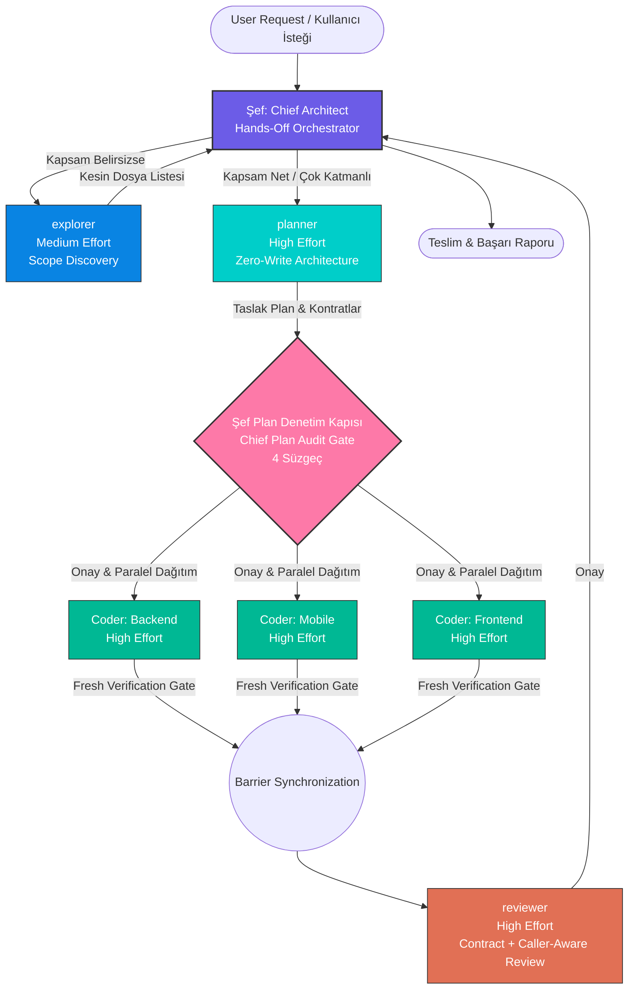

# ⚡ ecc-lite-orchestrator

> **High-Performance Multi-Agent Engineering Architecture & Zero-Token Autonomous Governance System**  
> *Antigravity & Claude Code için Yüksek Başarımlı Çoklu-Ajan Mühendislik Mimarisi ve Sıfır-Token Otonom Yönetim Sistemi*

[](https://opensource.org/licenses/MIT)
[](#-agent-matrix--roles)
[](#-0-token-os-guards)
[](#-quick-start)

---

## 🌐 Overview / Genel Bakış

**`ecc-lite-orchestrator`**, modern yapay zekâ destekli yazılım mühendisliğini rastgele prompt denemelerinden çıkarıp deterministik, cerrahi ve endüstri standardı bir mühendislik disiplinine dönüştüren hibrit bir orkestrasyon çerçevesidir.

Sistem, **1 Şef (Hands-Off Chief Architect)** ve **4 Evrensel Alt Ajan (`explorer`, `planner`, `coder`, `reviewer`)** hiyerarşisiyle çalışır. LLM context penceresini ham kodla şişirmek yerine, 5 saygın açık kaynak metodolojisinin en güçlü prensiplerini tek bir çatı altında birleştirir.

---

## 🧬 Architectural Philosophy (5-Repo Synthesis) / Mimari Sentez

`ecc-lite-orchestrator`, açık kaynak dünyasında kanıtlanmış 5 büyük paradigmanın sentezidir:

| # | Paradigm & Source | Primary Principles & Core Implementation |
|---|---|---|
| **1** | **Superpowers** | **Systematic Debugging & Verification Gate:** Hipotezsiz ve semptoma yönelik tahminî yama (ad-hoc patch) yasaktır. Test kanıtı olmadan başarı beyanı (`NO COMPLETION CLAIMS WITHOUT FRESH VERIFICATION EVIDENCE`) kabul edilmez. |
| **2** | **Ponytail** | **Minimalizm, YAGNI & Debt Ledger:** Sıfır kod şişkinliği (zero bloat), tek kullanımlık gereksiz soyutlamaları budama ve bilinçli teknik borçları `// shortcut:` etiketiyle kayıt altına alma. |
| **3** | **Karpathy Skills** | **Surgical Diffs & Low Cognitive Load:** Yalnızca hedef satırlara cerrahi müdahale. Komşu bloklara ve ilgisiz kodlara dokunmayarak diff gürültüsünü minimuma indirme. |
| **4** | **Claude-Mem** | **2-Aşamalı Progresif Arama (2-Stage Progressive Search):** 20 dosyalık context tüketimi yerine önce hafif bir indeks taranır (`kb search_index`), ardından yalnızca hedeflenen satırlar detayıyla yüklenir. |
| **5** | **ECC-Lite** | **0-Token OS Kalkanları (Pre-Tool Verification):** Gizli anahtar (secret) sızıntıları, yıkıcı komutlar ve regex kontrolleri LLM'e token harcatmadan yerel bash hook'ları ile engellenir. |

---

## 🏛️ Agent Matrix & Roles / Ajan Matrisi ve Rol Dağılımı

Sistem **1 Şef (Chief Architect)** ve **4 Evrensel Alt Ajan** ile çalışır. Tüm alt ajanlar **Gemini 3.8 Flash** modeli üzerinde çalışarak hız, yüksek mantıksal kavrayış ve düşük maliyet sağlar.



### Alt Ajan Tanımları

| Ajan | Model / Mod | Görev ve Sorumluluk Alanı | İzinler |
|---|---|---|---|
| **Şef (Chief Architect)** | Üst Orkestratör Model | Kullanıcı hedeflerini anlar, triyaj yapar, planı denetler ve kilitler. | **Salt Koordinatör:** Asla doğrudan kod yazmaz, dosya editlemez, terminal komutu çalıştırmaz. |
| **`explorer`** | Gemini 3.8 Flash *(Medium)* | Ponytail Scope Discovery: Hızlı sembol taraması, caller/fixture haritalama, max 150 kelime özet. | Salt Okunur (Read-Only) |
| **`planner`** | Gemini 3.8 Flash *(High)* | Ham kodları okuma yükünü context'inde yutar; 40-80 satırlık mimari plan, kilitli DTO/DB kontratları üretir. | Salt Okunur (Read-Only) |
| **`coder`** | Gemini 3.8 Flash *(High)* | Paralel N adet çağrılabilir (`Coder (Backend)`, `Coder (Mobile)`, `Coder (Frontend)`). Cerrahi kodlama yapar ve Verification Gate koşturur. | Yazma ve Yürütme (Write & Execute) |
| **`reviewer`** | Gemini 3.8 Flash *(High)* | İki Aşamalı Denetim: 1) Kilitli Kontrat Uyumu, 2) Caller-Aware derin denetim, güvenlik ve N+1 sorgu taraması. | Salt Okunur (Read-Only) |

---

## 🛡️ Chief Architect Plan Audit Gate (4 Süzgeç)

`planner` taslak planı tamamladığında, Şef bu planı doğrudan kullanıcıya veya coder'lara iletmez. Şef kendi zekasıyla planı **4 Baş Mimar Süzgecinden** geçirir:

1. **Ponytail Minimalizm & YAGNI Budaması:** Gereksiz tablolar, tek kullanımlık Factory/Interface'ler, lüzumsuz endpoint'ler ve gereksiz npm/nuget paketleri derhal budanır.
2. **Kontrat ve Katman Kilidi:** Paralel çalışacak kollar (Backend, Mobile, Frontend) arasındaki endpoint rotaları, HTTP metodları, DTO alan adları, tipleri ve nullability kuralları milimetrik kilitlenir.
3. **Karpathy Kapsam & Varsayım Kontrolü:** İstenmeyen komşu modüllere müdahale riski ve gizli varsayımlar ayıklanır.
4. **Güvenlik ve Veri Bütünlüğü:** Yetkilendirme (AuthZ), veri kaybı riskleri ve geriye dönük uyumluluk (backward compatibility) garantiye alınır.

---

## ⚖️ Parallelism vs. Serialization Matrix

| Geçiş / Aşama | İzin Verilen Mod | Kural ve Gerekçe |
|---|:---:|---|
| **`explorer` ↔ `planner`** | ⛔ **KESİNLİKLE SIRALI** | Asla paralel çağrılmaz! `planner` haritayı beklemeden kör arama yaparsa çift token yakılır ve Hızlı Hat şansı yok olur. |
| **`planner` ↔ `coder`** | ⛔ **KESİNLİKLE SIRALI** | Şef Plan Denetim Kapısı ve kilitli kontrat olmadan kodlama yapılamaz. |
| **`coder` ↔ `reviewer`** | ⛔ **KESİNLİKLE SIRALI** | Paralel `coder` kollarının tamamı bitmeden `reviewer` çağrılmaz. Parçalı inceleme mükerrer iş ve yanlış alarmlar üretir. |
| **Çoklu `explorer`** | ✅ **PARALEL SERBEST** | Farklı dizin veya katmanlarda birden fazla `explorer` eşzamanlı çalışabilir. Hepsi tamamlanınca Şef'e döner. |
| **Çoklu `coder`** | ✅ **PARALEL SERBEST** | Şef onayı sonrası katman bazlı `coder` ajanları (`Coder (Backend)`, `Coder (Mobile)`, `Coder (Frontend)`) tamamen paralel çalışır. |

---

## 🧰 10 Seçkin Mühendislik Becerisi (Skills)

Repo içinde kullanıma hazır 10 ana uzmanlık becerisi yer almaktadır:

1. **`systematic-debugging`**: Kök neden izole edilmeden, log/test ile kanıtlanmadan ve yeniden üretilmeden tahminî yama yapılmasını engeller.
2. **`tdd`**: Test-Driven Development döngüsü (.NET xUnit, Flutter test, Web Vitest). Önce başarısız test, ardından minimal kod, sonra refactor.
3. **`verification-gate`**: Kod değişikliği sonrası taze derleme, linter ve test çıktısını (Exit Code: 0) zorunlu kılan güvenlik kapısı.
4. **`tech-debt`**: Kod içindeki `// shortcut:` ve `// ponytail:` etiketlerini tek bir borç defterinde toplayarak unutulmasını önler.
5. **`deep-review`**: Caller-aware derin diff denetimi: Güvenlik açıkları, gerçek yük senaryoları, bellek sızıntıları ve eksik testler.
6. **`repo-audit`**: Kod tabanının genel sağlık denetimi; ölü kodların, gereksiz bağımlılıkların ve mimari aşınmaların tespiti.
7. **`using-git-worktrees`**: Çalışma alanını kirletmeden izole git worktree ortamlarında güvenli geliştirme yapılmasını sağlar.
8. **`handoff`**: Context dolduğunda mevcut durumu, kilitli kararları ve kalan adımları yapılandırılmış özette dondurur.
9. **`kb`**: `ecc-lite-brain` üzerinde 2 aşamalı progresif arama (İndeks -> Hedef Belge) ve NotebookLM entegrasyonu.
10. **`model-orchestrator`**: Görevin gereksinimine göre farklı modeller arasında dinamik görev dağıtımı ve mutabakat sağlar.

---

## 🛡️ 0-Token OS Kalkanları (Pre-Tool & Stop Hooks)

Modelin yapay zekâ jetonlarını harcamadan, işletim sistemi seviyesinde çalışan bash güvenlik ve doğrulama kalkanları:

- **`secret-guard.sh`**: Kod tabanında ve diff'lerde API anahtarlarını, private key'leri, `.env` içeriklerini ve hassas token'ları yerel regex taramasıyla algılar ve işlem anında durdurur (PreToolUse hook).
- **`verify-quiet.sh`**: Görev tamamlandığında değişen dosya türlerine (.NET, Flutter, Web/TS) göre derleme, tip ve analiz kontrollerini sessizce çalıştırır; başarılı durumda sıfır token harcar (Stop hook).

---

## 🚀 Quick Start / Hızlı Başlangıç

### Gereksinimler
- **macOS** veya **Linux** işletim sistemi
- **Bash 4+**
- **Python 3.8+** (MCP brain sunucusu için)
- **Antigravity** ve/veya **Claude Code CLI**

### 1. Kurulum (Tek Komutla)

Repoyu klonlayın ve idempotent kurulum scriptini çalıştırın:

```bash
git clone https://github.com/your-org/ecc-lite-orchestrator.git
cd ecc-lite-orchestrator

# Hem Antigravity hem Claude Code için varsayılan tam kurulum:
./install.sh

# Sadece Antigravity kurulumu için:
./install.sh --antigravity-only

# Sadece Claude Code sembolik bağları için:
./install.sh --claude-only
```

#### Kurulum Sırasında Gerçekleştirilen İşlemler:
1. Mevcut yapılandırmalar `~/.claude/backups/pre-install-<timestamp>` altına otomatik yedeklenir.
2. `plugins/ecc-lite` ve `plugins/orchestration` paketleri `~/.gemini/config/plugins/` altına senkronize edilir.
3. **Kritik:** Mevcut `instincts.md` (öğrenilen refleksler) **kesinlikle ezilmez ve korunur**. Yoksa `instincts.example.md`'den türetilir.
4. `~/.gemini/config/mcp_config.json` dosyasına `ecc-lite-brain` Python MCP sunucusu atomik olarak eklenir.
5. Claude Code için `~/.agents/` ve `~/.claude/{agents,skills}` sembolik bağlantıları kurulur.

### 2. Kaldırma (Güvenli Temizlik)

Sistemi kaldırmak istediğinizde:

```bash
# Güvenli kaldırma (Sembolik bağları ve MCP kaydını temizler, instincts.md dosyasını yedekler):
./uninstall.sh

# Eklenti klasörlerini de tamamen silmek için:
./uninstall.sh --all
```

---

## 📂 Repository Structure / Dizin Yapısı

```
ecc-lite-orchestrator/
├── install.sh              # Idempotent dual-mode installer (Antigravity & Claude Code)
├── uninstall.sh            # Safe cleanup script with instinct preservation
├── README.md               # Architecture documentation & system manual
├── LICENSE                 # MIT License
├── .gitignore              # Ignores runtime state, instincts.md, and bytecode
└── plugins/
    ├── ecc-lite/           # Core tools, 0-token hooks, KB brain & MCP server
    │   ├── hooks/          # secret-guard.sh, verify-quiet.sh
    │   ├── kb/             # instincts.example.md, knowledge topics
    │   ├── mcp/            # brain_server.py (MCP protocol implementation)
    │   ├── rules/          # Engineering rules, Karpathy/Ponytail guidelines
    │   └── skills/         # 10 essential engineering skills
    └── orchestration/      # Chief Architect & 4 subagent definitions
        ├── agents/         # explorer.md, planner.md, coder.md, reviewer.md
        ├── rules/          # AGENTS.md (Chief gate, triage & parallelism matrix)
        └── skills/         # orchestrator skill
```

---

## 📄 License

Bu proje [MIT Lisansı](LICENSE) kapsamında lisanslanmıştır.
