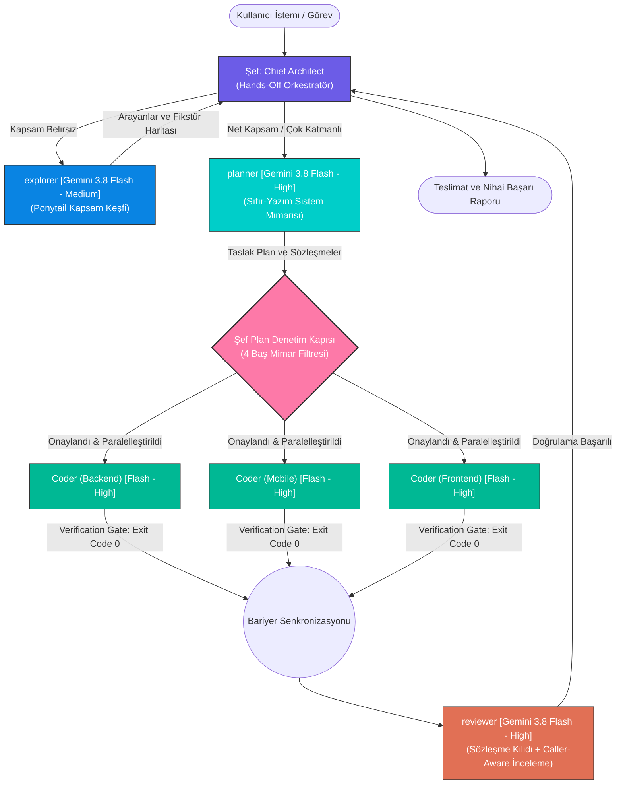

# 🧠 Synapse Agents

> **Antigravity, Claude Code ve Cursor İçin Birleşik Çoklu-Ajan Orkestrasyonu ve Sıfır-Token Mühendislik Kalkanları**  
> 🌐 **Language / Dil:** [🇬🇧 English](README.md) | **[🇹🇷 Türkçe](README.tr.md)**

[](https://opensource.org/licenses/MIT)
[](#-ajan-matrisi-ve-rol-dağılımı)
[](#-ajan-matrisi-ve-rol-dağılımı)
[](#-0-token-os-kalkanları-ve-aşamalı-bellek)
[](#-üçlü-platform-desteği)

---

## 🌐 Genel Bakış

**`synapse-agents`**, modern yapay zekâ destekli yazılım mühendisliğini rastgele prompt denemelerinden çıkarıp deterministik, cerrahi ve kurumsal standartta test edilmiş bir mühendislik disiplinine dönüştüren hibrit bir çoklu-ajan orkestrasyon çerçevesidir.

Sistem, **1 Şef (Hands-Off Chief Architect)** ve **4 Evrensel Alt Ajan (`explorer`, `planner`, `coder`, `reviewer`)** hiyerarşisiyle çalışır ve tüm alt ajanlar istisnasız **Gemini 3.8 Flash** (High ve Medium Effort modlarında) üzerinde yürütülür. LLM bağlam (context) penceresini onlarca kaynak kod dosyasıyla şişirmek yerine, açık kaynak dünyasında kanıtlanmış 5 büyük metodolojinin en güçlü ilkelerini tek bir çatı altında birleştirir.

---

## 🏛️ Mimari Doğuş: Synapse Agents Sistemini Nasıl ve Neden Kurduk?

Her dirençli ve uzun ömürlü mühendislik çerçevesi, can sıkan gerçek bir darboğazı çözmek amacıyla doğar. Bizim günlük kurumsal üretim süreçlerimizde karşılaştığımız temel darboğaz, otonom yapay zekâ modellerinin kod yazımındaki 3 kronik arızasıydı:

1. **Context Penceresi Şişmesi ve Halüsinasyon:** Tek bir ana konuşma modeline aynı oturumda dosya aratmak, mimari plan çıkarttırmak, katmanlar arası kod yazdırmak ve test koşturmak; context penceresine 20–30 ham dosyanın ve binlerce satır terminal çıktısının dolmasına yol açıyordu. Model kaçınılmaz olarak erken talimatları unutuyor, var olmayan metotlar uyduruyor (halüsinasyon) ve sessiz regresyonlara neden oluyordu.
2. **Tahminî ve Semptomatik Yamalar (Ad-Hoc Patching):** Ajanlar kök nedeni testle izole edip kanıtlamadan semptomlara yönelik acele yamalar atıyor, her sözde düzeltme başka bir modülü kırarak sonsuz hata ayıklama döngülerine yol açıyordu.
3. **Şişkin Soyutlamalar ve Kontrolsüz Kapsam:** Üretken modeller tek satırlık bir iş için gereksiz arayüzler, fabrikalar, ara DTO katmanları ve harici npm/nuget paketleri ekleyerek teknik borcu katlıyordu.

### 5 Açık Kaynak Reponun Kaynak Kod Seviyesinde Analizi

Kendi yerel **ECC-Lite** çekirdeğimiz (0-token OS kalkanları, domain kuralları ve hafif MCP bellek sunucusu) zaten üretimdeydi. Ancak tekerleği sıfırdan icat etmek ya da harici bir araca körü körüne teslim olmak yerine, ekosistemdeki en popüler 5 açık kaynak mühendislik reposunu klonlayıp kaynak kod seviyesinde tek tek derinlemesine inceledik:

1. **[obra/superpowers](https://github.com/obra/superpowers)**
2. **[DietrichGebert/ponytail](https://github.com/dietrichgebert/ponytail)**
3. **[multica-ai/andrej-karpathy-skills](https://github.com/multica-ai/andrej-karpathy-skills)**
4. **[thedotmack/claude-mem](https://github.com/thedotmack/claude-mem)**
5. **[JuliusBrussee/caveman](https://github.com/juliusbrussee/caveman)**

### Mimari Sentez ve Eleme Matrisi

Tek bir repoyu körü körüne benimsemek yerine, her felsefenin en üstün mekanizmasını çekip aldık ve operasyonel risk yaratan kısımlarını kararlılıkla eledik:

| Kaynak Repo | Entegre Edilen Temel İlke | Neden Synapse Agents İçine Entegre Ettik? | Bilinçli Olarak Neyi Reddettik ve Neden? |
|---|---|---|---|
| **[obra/superpowers](https://github.com/obra/superpowers)** | **Sistematik Hata Ayıklama & Verification Gate** | Demir kural: *"Taze doğrulama kanıtı olmadan başarı beyanı yasaktır."* Kod teslim edilmeden önce ilgili terminal test/derleme komutlarının (exit code 0 kanıtı ile) bizzat çalıştırılmasını zorunlu kıldık. | Ağır ve Python'a bağımlı monolitik ajan betiklerini eledik; yerine her dille uyumlu bağımsız alt ajan mimarisi kurduk. |
| **[DietrichGebert/ponytail](https://github.com/dietrichgebert/ponytail)** | **Ponytail Minimalizm, YAGNI & Borç Defteri** | Tek kullanımlık soyutlamaları, gereksiz fabrikaları ve şişkin kütüphaneleri acımasızca budar. Bilinçli geçici çözümleri `// shortcut: <limit>, <tetikleyici>` ile borç defterine kaydeder. | Yalnızca tek dosyalık betik yürütme kısıtını aştık; Ponytail yaklaşımını kapsamlı bir **Caller-Aware Review** ve **Scope Discovery** aşamasına yükselttik. |
| **[multica-ai/andrej-karpathy-skills](https://github.com/multica-ai/andrej-karpathy-skills)** | **Karpathy Cerrahi Değişiklikleri & Düşük Bilişsel Yük** | Düzenlemeler yalnızca görevin gerektirdiği satırlara cerrahi hassasiyetle dokunur. Komşu bloklar, ilgisiz formatlamalar ve mevcut yorumlar korunarak diff gürültüsü sıfırlanır. | Monolitik prompt yapısını eledik; cerrahi kodlamayı bağımsız ve paralel çalışabilen `coder` alt ajanlarına devrettik. |
| **[thedotmack/claude-mem](https://github.com/thedotmack/claude-mem)** | **2-Aşamalı Progresif Bellek Araması** | Onlarca dokümantasyon dosyasını tek seferde context'e dökmek yerine, önce hafif konu indeksi taranır (`search_knowledge_index`), ardından yalnızca hedeflenen detaylar (`get_knowledge_detail`) çekilir. | **Arka Plan Servisini Reddettik:** Bun, SQLite, ChromaDB ve vektör embedding çalıştıran arka plan daemon'ları soket sızıntısına, bellek şişmesine ve zombi süreçlere yol açar. Bu prensibi sıfır bağımlılıklı, talep üzerine uyanan hafif Python MCP sunucusu (`ecc-lite-brain`) ile hayata geçirdik. |
| **[JuliusBrussee/caveman](https://github.com/juliusbrussee/caveman)** | *Kavramsal Token Verimliliği Arayışı* | Token israfına karşı duyulan radikal hassasiyet fikrini takdir ettik. | **Yöntemi Reddettik (Bozuk Dil):** Dili mağara adamı gibi tek heceli, bozuk gramerli hale getirmek modern öncü modellerin (Gemini 3.8 Flash) derin düşünce zincirini (chain-of-thought) ve mimari kavrayışını sakatlar. Biz token tasarrufunu dili bozarak değil, mimari triyaj ve progresif aramayla sağladık. |
| **[ecc-lite](https://github.com/muhammeteminozturk/ecc-lite)** | **0-Token OS Kalkanları & Çoklu Platform Sembolik Bağları** | Araç öncesi parametre denetimleri, yıkıcı komut engelleme ve gizli anahtar (secret) taramaları yerel bash hook'ları ile işletim sistemi hızında ve 0 model token'ı harcanarak icra edilir. | N/A — Tüm çerçevenin kurumsal omurgasını ve yerel güvenlik temelini oluşturdu. |

### Synapse Agents Kırılma Noktası: Hands-Off Şef + 4 Evrensel Alt Ajan

Bu sentez sonucunda **Synapse Agents** mimarisini geliştirdik:
- **Şef İçin %0 Ham Kod Okuma (Sıfır Context Şişmesi):** Ana konuşulan model (Hands-Off Chief Architect) context penceresine ASLA ham kod dosyaları basmaz. Kod taramayı `explorer`'a, mimari planlamayı `planner`'a, cerrahi uygulamayı paralel `coder` izleklerine, güvenlik ve sözleşme denetimini ise `reviewer`'a devreder.
- **4 Süzgeçli Şef Baş Mimar Denetim Kapısı:** Hazırlanan planlar kullanıcıya veya kodlayıcılara sunulmadan önce Şef tarafından Ponytail Minimalizmi, Sözleşme & Katman Kilidi, Karpathy Kapsam Kontrolü ve Güvenlik filtrelerinden geçirilir.
- **Sadece Gemini 3.8 Flash (High/Medium Effort):** Gemini 3.8 Flash'ın derin muhakeme gücünü ve hızını tam verimle kullanacak şekilde optimize edilmiştir.

---

## 🖥️ Üçlü Platform Desteği

`synapse-agents`, tek bir tutarlı kurulum mekanizması üzerinden üç büyük yapay zekâ geliştirme platformunu destekler:

```
┌────────────────────────────────────────────────────────────────────────┐
│                             synapse-agents                             │
│              Çekirdek Eklentiler, 10 Beceri, 0-Token Kalkanlar         │
└──────────────┬─────────────────────────┬───────────────────────────────┘
               │                         │
      ┌────────▼────────┐       ┌────────▼────────┐       ┌──────────────▼────────┐
      │   Antigravity   │       │   Claude Code   │       │      Cursor IDE       │
      │   (Gemini CLI)  │       │      (CLI)      │       │     (Genel / Proje)   │
      └────────┬────────┘       └────────┬────────┘       └──────────────┬────────┘
               │                         │                               │
  • ~/.gemini/config/plugins/   • ~/.agents/                     • ~/.cursor/mcp.json
  • ~/.gemini/config/           • ~/.claude/agents/              • ~/.cursor/rules/*.mdc
    mcp_config.json             • ~/.claude/skills/              • ~/.cursor/skills/
                                • ~/.claude/rules                • ~/.cursor/agents/
                                                                 • <proje>/.cursor/
```

### 1. Google Antigravity
* Eklenti kayıtları: `~/.gemini/config/plugins/ecc-lite` ve `~/.gemini/config/plugins/orchestration`.
* MCP yapılandırması: `~/.gemini/config/mcp_config.json` altında `ecc-lite-brain` kaydı.

### 2. Claude Code CLI
* Sembolik bağlar: `~/.agents/` (`hooks`, `kb`, `mcp`, `rules`, `skills`).
* Ajanlar `~/.claude/agents/`, uzmanlık becerileri ise `~/.claude/skills/` altına bağlanır.

### 3. Cursor IDE (Genel & Proje Bazlı)
* MCP sunucu kaydı: `~/.cursor/mcp.json`.
* Kural setleri Cursor MDC kuralları olarak `~/.cursor/rules/*.mdc` altına bağlanır.
* Genel ajan ve beceriler `~/.cursor/agents/` ve `~/.cursor/skills/` altındadır.
* Projeye özel kurulum `./install.sh --cursor-project <dizin>` ile sağlanır.

---

## 🏛️ Ajan Matrisi ve Rol Dağılımı

Sistem, **1 Şef (Hands-Off Chief Architect)** ve **4 Evrensel Alt Ajan** hiyerarşisiyle çalışır. Hız, mantıksal kavrayış ve maliyet verimliliğini en üst seviyeye çıkarmak için tüm alt ajanlar istisnasız **Gemini 3.8 Flash** modeli üzerinde çalıştırılır.



### Ajan Kadrosu ve Yetki Matrisi

| Ajan | Model ve Efor Seviyesi | Temel Görevi | Araç Yetkileri |
|---|---|---|:---:|
| **Şef (Chief Architect)** | Lider Orkestratör Model (Örn. Gemini 4 Argon) | Kullanıcı hedefini anlar, triyaj uygular, denetim kapılarını işletir ve alt ajanları yönetir. | **Yalnızca Koordinatör:** Kod yazma (`write_to_file`, `replace_file_content`) YOK, terminal çalıştırma YOK, ham kod okuma YOK. |
| **`explorer`** | Gemini 3.8 Flash *(Medium Effort)* | **Ponytail Kapsam Keşfi:** Arayanları, bağımlılıkları, testleri ve yapılandırmaları haritalar; özet sunar (maks. 150 kelime). | Salt Okunur (Read-Only) |
| **`planner`** | Gemini 3.8 Flash *(High Effort)* | Ham dosyaları izole context'te okur; kilitli DTO/DB sözleşmeleriyle 40–80 satırlık mimari plan üretir. | Salt Okunur (Read-Only) |
| **`coder`** | Gemini 3.8 Flash *(High Effort)* | N paralel rolde çağrılır (`Coder (Backend)`, `Coder (Mobile)` vb.); cerrahi kodlama yapar ve Verification Gate'i işletir. | Yazma ve Çalıştırma |
| **`reviewer`** | Gemini 3.8 Flash *(High Effort)* | İki Aşamalı İnceleme: 1) Kilitli Sözleşme Uyumu, 2) Ponytail Caller-Aware derin inceleme, güvenlik ve N+1 sorgu taraması. | Salt Okunur (Read-Only) |

---

## 🛡️ Şef Baş Mimar Plan Denetim Kapısı (4 Filtre)

`planner` taslak bir plan sunduğunda, Şef bu planı **asla doğrudan kullanıcıya veya kodlayıcılara iletmez**. Plan mutlaka **4 Baş Mimar Filtresi**'nden geçirilir:

1. **Ponytail Minimalizmi & YAGNI Budaması:** Gereksiz veritabanı tabloları, tek kullanımlık fabrika sınıfları, kullanılmayan uç noktalar, spekülatif soyutlamalar ve harici bağımlılıklar acımasızca budanır.
2. **Katmanlar Arası Sözleşme ve Nullability Kilidi:** Uç nokta URL'leri, HTTP fiilleri, yük anahtarları, isimlendirme kuralları, veri tipleri ve null olabilirlik kuralları Backend, Mobile ve Web Admin arasında %100 eşitlenir.
3. **Karpathy Kapsam ve Varsayım Kontrolü:** Görevle ilgisiz komşu dosyaların plana dahil edilmediği doğrulanır ve kullanıcı netleştirmesi gerektiren gizli varsayımlar ayıklanır.
4. **Yetkilendirme ve Veri Güvenliği:** Doğru yetkilendirme (AuthZ) denetimleri, veri bütünlüğü, veri kaybına yol açmayan güvenli migrasyonlar ve geriye dönük uyumluluk garanti edilir.

> [!IMPORTANT]
> Herhangi bir şişkinlik veya hata tespit edilirse, Şef ya `send_message` ile planı daralttırır ya da doğrudan budayıp kilitler. Yalnızca denetlenmiş ve onaylanmış plan yürütmeye alınır.

---

## 🚦 Akıllı Triyaj: Hızlı Atlama (Fast Bypass) vs. Tam Orkestrasyon

```
                     Kapsam zaten net mi?
                              │
               ┌──────────────┴──────────────┐
              EVET                          HAYIR
               │                             │
       Değişiklik <= 2 dosyayı        explorer çağrılır
       ve 0 sözleşme değişimini       (Ponytail Kapsam Keşfi)
       mi etkiliyor?                         │
        │             │               Keşif <= 2 dosya ve
       EVET         HAYIR             0 sözleşme mi buldu?
        │             │                      │
        │             │            ┌─────────┴─────────┐
        │             │           EVET                HAYIR
        ▼             ▼            │                   │
   [ HIZLI        [ TAM            ▼                   ▼
    ATLAMA ]    ORKESTRASYON] [ HIZLI             [ TAM
    1x Coder     Planner       ATLAMA ]         ORKESTRATION]
    doğrudan     zorunlu       1x Coder          Kapsam Planner'a
                               doğrudan          beslenir
```

* **Hızlı Atlama (Fast Bypass):** Kapsamı dar (`<= 2` dosya, 0 sözleşme/şema değişikliği, hata düzeltmesi, UI makyajı) işlerde planlama bürokrasisi tamamen baypas edilir. Şef doğrudan `1x coder` atar; kodlayıcı cerrahi değişikliği yapıp taze test kanıtıyla teslim eder.
* **Tam Orkestrasyon:** Çok katmanlı özellikler, şema güncellemeleri veya `> 2` dosyaya yayılan işlerde tam boru hattı (`explorer` → `planner` → Şef Denetim Kapısı → Paralel `coder`lar → `reviewer`) tavizsiz uygulanır.

---

## ⚖️ Eşzamanlılık vs. Sıralılık Matrisi

Yarış koşullarını (race condition), bağlam israfını ve çakışmaları önlemek için ajan geçişleri katı kurallara bağlıdır:

| Geçiş / Aşama | İzin Verilen Mod | Kural ve Gerekçe |
|---|:---:|---|
| **`explorer` ↔ `planner`** | ⛔ **KESİNLİKLE SIRALI** | **Asla paralel çalıştırılamaz!** Aynı anda başlatılırsa `planner` keşif haritasını bekleyemez, kör aramalarla boşuna token yakar ve Hızlı Atlama triyajını bozar. |
| **`planner` ↔ `coder`** | ⛔ **KESİNLİKLE SIRALI** | **Asla paralel çalıştırılamaz!** Şef Denetim Kapısı'ndan geçmemiş ve sözleşmeleri kilitlenmemiş kodlama, entegrasyon ayrışmasına ve kod israfına yol açar. |
| **`coder` ↔ `reviewer`** | ⛔ **KESİNLİKLE SIRALI** | **Asla paralel çalıştırılamaz!** Parçalı incelemeler mükerrer efora ve sahte pozitiflere neden olur. İnceleme ancak tüm kodlayıcılar bariyer senkronizasyonunu tamamlayınca başlar. |
| **Çoklu-`explorer`** | ✅ **PARALEL UYGUN** | Ayrık dizinler veya katmanlar (ör. backend ve mobile) için birden fazla explorer paralel koşabilir. Ancak hepsi bitmeden `planner` başlayamaz. |
| **Çoklu-`coder`** | ✅ **PARALEL UYGUN** | Şef plan onayından sonra, katman bazlı kodlayıcılar (`Coder (Backend)`, `Coder (Mobile)`, `Coder (Frontend)`) tamamen eşzamanlı çalışır. |

---

## 🔄 Kesintisiz Yürütme (`Ruling:` Protokolü)

Yürütme sırasında ajanlar önemsiz mikro kararlar için kullanıcıyı gereksiz sorularla duraklatmaz:

1. **Sormadan Önce Kod Tabanını İncele:** Ajanlar cevabı kod tabanında veya `ecc-lite-brain` belleğinde bulunan soruları asla kullanıcıya sormaz.
2. **`Ruling:` Protokolü:** Alınan teknik inisiyatifler denetim günlüğüne standart formatta kaydedilir:
   ```markdown
   Ruling: <Karar> — <Teknik Gerekçe> — <Yanlışsa Geri Dönüş Maliyeti>
   ```
3. **Kullanıcıya Başvurulacak 4 İstisnai Durum:**
   * Yıkıcı eylemler (tablo silme, kalıcı dosya kaldırma).
   * Gizli anahtarlar ve kimlik bilgileri (yeni API anahtarları, token üretimi).
   * Dış yan etkiler (git push, uzak sunucuya dağıtım, mağazaya yayınlama).
   * Aşılamayan mimari kilitlenmeler.

---

## 🧰 10 Seçkin Mühendislik Becerisi (Skills)

Çalışma alanı, endüstri standardı 10 seçkin mühendislik becerisiyle donatılmıştır:

1. **`systematic-debugging`**: Hata düzeltilmeden önce kök nedenin izole edilmesini ve testle yeniden üretilmesini zorunlu kılar.
2. **`tdd`**: .NET (xUnit), Flutter (test) ve Web (Vitest) üzerinde katı Test-Güdümlü Geliştirme (TDD) iş akışı sağlar.
3. **`verification-gate`**: İşi tamamlandı ilan etmeden önce taze derleme, lint ve test çalıştırmasını (Exit Code: 0) şart koşar.
4. **`tech-debt`**: Kod tabanındaki tüm `// shortcut:` ve `// ponytail:` etiketlerini toplayıp tek bir borç defterine dönüştürür.
5. **`deep-review`**: Sınır durumları, bellek sızıntılarını, güvenliği ve yük performansını denetleyen arayan-farkındalıklı (caller-aware) derin diff incelemesi sunar.
6. **`repo-audit`**: Ölü kodları, şişkin paketleri ve yapısal çürümeyi tespit eden derin sağlık denetimi uygular.
7. **`using-git-worktrees`**: Özellik dallarını ana çalışma ağacından izole etmek için git worktree kullanımını otomatikleştirir.
8. **`handoff`**: Context penceresi dolmaya yaklaştığında mevcut durumu, kararları ve kalan işleri dondurup kaydeder.
9. **`kb`**: `ecc-lite-brain` indeksi ve dokümantasyonunu 2-aşamalı progresif yöntemle tarar; NotebookLM entegrasyonu sunar.
10. **`model-orchestrator`**: Gemini ve NVIDIA NIM motorları arasında dinamik görev dağıtımı ve çoklu-model konsensüsü sağlar.

---

## 🛡️ 0-Token OS Kalkanları ve Aşamalı Bellek

### 1. Sıfır-Token OS Kalkanları (`plugins/ecc-lite/hooks/`)
* **`secret-guard.sh` (Araç Öncesi Kanca):** Dosya düzenlemelerini ve terminal komutlarını işletim sistemi seviyesinde hızlı regex desenleriyle inceler. Özel anahtarların, API şifrelerinin, `.env` dökümlerinin ve yıkıcı komutların sızmasını 0 model token harcayarak anında engeller.
* **`verify-quiet.sh` (Durdurma Kancası):** Görev bitiminde tetiklenir; değiştirilen dosya uzantılarını (.NET, Flutter, Web/TS) analiz ederek arka planda sessizce derleme ve tip denetimi yapar. Çıkış kodu 0 ise modele sıfır token basarak tamamen sessiz kalır.

### 2. 2-Aşamalı Progresif Bellek (`ecc-lite-brain`)
* **1. Aşama (`search_knowledge_index`):** Yalnızca başlık ve kısa özetleri tarar (çok düşük token maliyeti).
* **2. Aşama (`get_knowledge_detail`):** Sadece eşleşen konunun tam markdown detayını context'e yükler.
* **Refleks Motoru (`kb/instincts.md`):** Projeye özel isimlendirme geleneklerini, mimari sınırları ve DTO kurallarını hafızada tutar.

---

## 🚀 Kurulum ve Kullanım Kılavuzu

### Önkoşullar
* **macOS** veya **Linux**
* **Bash 4.0+**
* **Python 3.8+** (standart kütüphane tabanlı MCP sunucusu için)
* **Antigravity**, **Claude Code CLI** veya **Cursor IDE**

### 1. Kurulum

Depoyu klonlayın ve idempotent yükleyiciyi çalıştırın:

```bash
git clone https://github.com/meminozturkk/synapse-agents.git
cd synapse-agents

# Varsayılan: Antigravity, Claude Code ve Cursor IDE (Genel) için kurar
./install.sh

# Platforma özel hedeflenmiş kurulumlar:
./install.sh --antigravity-only
./install.sh --claude-only
./install.sh --cursor-only

# Projeye özel Cursor yapılandırması:
./install.sh --cursor-project /projenizin/tam/yolu
```

#### Yükleyicinin Yaptığı İşlemler:
1. **Otomatik Yedekleme:** Mevcut eklenti ve ajan yapılandırmalarını `~/.claude/backups/pre-install-<zaman_damgası>` altına yedekler.
2. **Antigravity Senkronizasyonu:** `ecc-lite` ve `orchestration` eklentilerini `~/.gemini/config/plugins/` altına kopyalar.
3. **Reflekslerin Korunması:** **Mevcut `instincts.md` dosyaları asla ezilmez.** Takımın öğrendiği refleksler 3 katmanlı koruma ile saklanır.
4. **MCP Brain Kaydı:** `ecc-lite-brain` sunucusunu `~/.gemini/config/mcp_config.json` ve `~/.cursor/mcp.json` içine atomik olarak kaydeder.
5. **Claude ve Cursor Bağlantıları:** `~/.agents/`, `~/.claude/` ve `~/.cursor/` altında gerekli sembolik bağları (`symlink`) üretir.

### 2. Kaldırma (Uninstall)

Öğrenilen takım reflekslerini kaybetmeden çerçeveyi güvenle kaldırabilirsiniz:

```bash
# Güvenli kaldırma (symlink ve MCP kayıtlarını temizler; instincts.md yedeğini alır):
./uninstall.sh

# Tamamen temizleme (tüm kurulu eklenti dosyalarını ve yapılandırmaları siler):
./uninstall.sh --all
```

---

## 📂 Depo Yapısı

```
synapse-agents/
├── install.sh              # Çoklu platform yükleyici (Antigravity, Claude Code, Cursor)
├── uninstall.sh            # Yedekleme garantili güvenli kaldırma betiği
├── README.md               # İngilizce ana mimari ve sistem dokümantasyonu
├── README.tr.md            # Türkçe eksiksiz mimari ve sistem dokümantasyonu
├── LICENSE                 # MIT Lisansı
├── .gitignore              # Çalışma zamanı durumları, Python bytecode ve instincts.md yok sayılır
└── plugins/
    ├── ecc-lite/           # Çekirdek araçlar, 0-token hook'ları, KB brain & MCP sunucusu
    │   ├── hooks/          # secret-guard.sh, verify-quiet.sh
    │   ├── kb/             # instincts.example.md, bilgi konuları
    │   ├── mcp/            # brain_server.py (Hafif ve bağımsızlıksız Python MCP uygulaması)
    │   ├── rules/          # Karpathy cerrahi ve Ponytail minimalizm kuralları
    │   └── skills/         # 10 seçkin mühendislik becerisi
    └── orchestration/      # Şef Baş Mimar ve 4 alt ajan tanımları
        ├── agents/         # explorer.md, planner.md, coder.md, reviewer.md
        ├── rules/          # AGENTS.md (Şef denetim kapısı, triyaj ve paralellik matrisi)
        └── skills/         # orchestrator uzmanlık becerisi
```

---

## 📄 Lisans

Bu proje [MIT Lisansı](LICENSE) kapsamında lisanslanmıştır.
