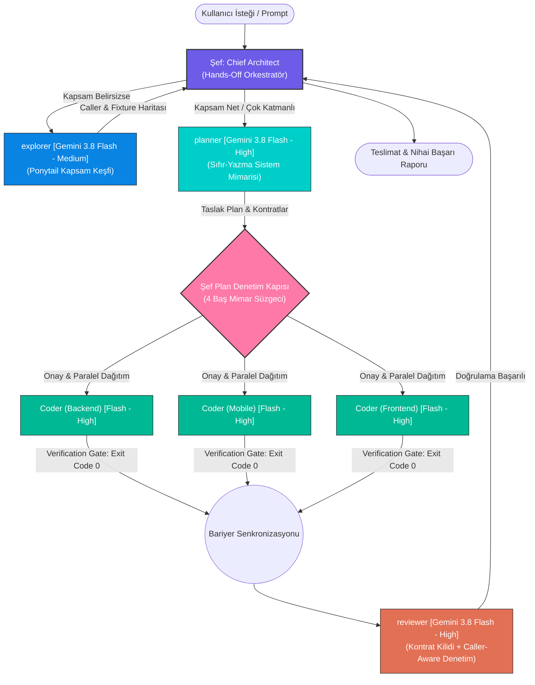

# ⚡ ecc-lite-orchestrator

> 🌐 **Language / Dil:** [🇬🇧 English](README.md) | **[🇹🇷 Türkçe](README.tr.md)**

[](https://opensource.org/licenses/MIT)
[](#-ajan-matrisi-ve-rol-dağılımı)
[](#-ajan-matrisi-ve-rol-dağılımı)
[](#-0-token-os-kalkanları-ve-aşamalı-bellek)
[](#-üçlü-platform-desteği)

---

## 🌐 Genel Bakış

**`ecc-lite-orchestrator`**, modern yapay zekâ destekli yazılım mühendisliğini rastgele prompt denemelerinden çıkarıp deterministik, cerrahi ve kurumsal standartta test edilmiş bir mühendislik disiplinine dönüştüren hibrit bir çoklu-ajan orkestrasyon çerçevesidir.

Sistem, **1 Şef (Hands-Off Chief Architect)** ve **4 Evrensel Alt Ajan (`explorer`, `planner`, `coder`, `reviewer`)** hiyerarşisiyle çalışır ve tüm alt ajanlar istisnasız **Gemini 3.8 Flash** (High ve Medium Effort modlarında) üzerinde yürütülür. LLM bağlam (context) penceresini onlarca kaynak kod dosyasıyla şişirmek yerine, açık kaynak dünyasında kanıtlanmış 5 büyük metodolojinin en güçlü ilkelerini tek bir çatı altında birleştirir.

---

## 🧬 Mimari Felsefe (5 Reponun Sentezi)

`ecc-lite-orchestrator`, açık kaynak ajan mühendisliği topluluğunun en güçlü pratiklerini benimserken, şişkin ve güvenilmez kalıpları bilinçli olarak reddeder:

| # | Paradigma & Kaynak | Temel İlkeler ve Çekirdek Uygulama |
|:---:|---|---|
| **1** | **[obra/superpowers](https://github.com/obra/superpowers)** | **Sistematik Hata Ayıklama & Verification Gate:** Tahminî yama ve semptom düzeltmesi kesinlikle yasaktır. Kök neden izole edilmeden ve log/test ile kanıtlanmadan düzeltme yapılamaz. **"NO COMPLETION CLAIMS WITHOUT FRESH VERIFICATION EVIDENCE"** (terminalde exit code 0 taze kanıtı zorunludur). |
| **2** | **[DietrichGebert/ponytail](https://github.com/DietrichGebert/ponytail)** | **Ponytail Minimalizm, YAGNI & Borç Defteri:** Tek kullanımlık soyutlamalar, gereksiz fabrikalar ve şişkin paketler acımasızca budanır. Bilinçli geçici çözümler `// shortcut: <limit>, <tetikleyici>` formatında borç defterine kaydedilir. **Ponytail Kapsam Keşfi (Scope Discovery)** içerir. |
| **3** | **[multica-ai/andrej-karpathy-skills](https://github.com/multica-ai/andrej-karpathy-skills)** | **Cerrahi Diff'ler & Düşük Bilişsel Yük:** Düzenlemeler yalnızca görevin gerektirdiği satırlarla sınırlıdır. Komşu bloklara, ilgisiz fonksiyonlara ve mevcut kod biçimlendirmesine dokunulmaz; diff gürültüsü ve regresyon riski sıfırlanır. |
| **4** | **[thedotmack/claude-mem](https://github.com/thedotmack/claude-mem)** | **2-Aşamalı Progresif Arama (2-Stage Progressive Search):** Onlarca dokümantasyon dosyası context'e asla tek seferde basılmaz. Önce hafif konu indeksi taranır (`search_knowledge_index`), ardından yalnızca hedeflenen detay bölümler çekilir (`get_knowledge_detail`). |
| **5** | **[ecc-lite](https://github.com/muhammeteminozturk/ecc-lite)** | **0-Token OS Kalkanları:** Araç öncesi (pre-tool) parametre doğrulamaları ve gizli anahtar (secret) taramaları yerel bash hook'ları (`secret-guard.sh`, `verify-quiet.sh`) ile işletim sistemi hızında ve sıfır model token harcayarak yürütülür. |

### 🚫 Bilinçli Olarak Reddedilen Yaklaşımlar

Yüksek akıl yürütme kalitesini ve operasyonel kararlılığı korumak adına, toplulukta popüler olan iki yaklaşım mimari kararla reddedilmiştir:

1. **`caveman` (Aşırı Token Sıkıştırma / Bozuk Dil Kullanımı):**  
   Model çıktılarını veya sistem bağlamını tek heceli, bozuk "mağara adamı" tarzı dille sıkıştırmaya çalışmak; modelin düşünce zinciri (chain-of-thought) derinliğini, anlamsal kavrayışını ve mimari kesinliğini zedeler. Biz token tasarrufunu dili bozarak değil, **Ponytail Minimalizmi** ve **2-Aşamalı Progresif Bellek** ile çok daha temiz sağlarız.
2. **`claude-mem` Arka Plan Servisi (Background Daemon):**  
   Arka planda kesintisiz çalışan ağır servisler soket sızıntılarına, kontrolsüz bellek şişmesine, zombi süreçlere ve gizli CPU/token yoklamalarına yol açar. `ecc-lite-orchestrator`, bunun yerine yalnızca sorgu geldiğinde çalışan, talep-bazlı ve hafif bir Python standart kütüphane MCP sunucusu (`ecc-lite-brain`) kullanır.

---

## 🖥️ Üçlü Platform Desteği

`ecc-lite-orchestrator`, tek bir tutarlı kurulum mekanizması üzerinden üç büyük yapay zekâ geliştirme platformunu destekler:

```
┌────────────────────────────────────────────────────────────────────────┐
│                        ecc-lite-orchestrator                           │
│              Çekirdek Eklentiler, 10 Beceri, 0-Token Kalkanlar         │
└──────────────┬─────────────────────────┬───────────────────────────────┘
               │                         │
      ┌────────▼────────┐       ┌────────▼────────┐       ┌──────────────▼────────┐
      │   Antigravity   │       │   Claude Code   │       │      Cursor IDE       │
      │   (Gemini CLI)  │       │      (CLI)      │       │     (Global / Proje)  │
      └────────┬────────┘       └────────┬────────┘       └──────────────┬────────┘
               │                         │                               │
  • ~/.gemini/config/plugins/   • ~/.agents/                     • ~/.cursor/mcp.json
  • ~/.gemini/config/           • ~/.claude/agents/              • ~/.cursor/rules/*.mdc
    mcp_config.json             • ~/.claude/skills/              • ~/.cursor/skills/
                                • ~/.claude/rules                • ~/.cursor/agents/
                                                                 • <proje>/.cursor/
```

### 1. Google Antigravity
* Eklenti kayıtları: `~/.gemini/config/plugins/ecc-lite` ve `~/.gemini/config/plugins/orchestration`.
* MCP yapılandırması: `~/.gemini/config/mcp_config.json` altında `ecc-lite-brain` kaydı.

### 2. Claude Code CLI
* Sembolik bağlar: `~/.agents/` (`hooks`, `kb`, `mcp`, `rules`, `skills`).
* Ajanlar `~/.claude/agents/`, uzmanlık becerileri ise `~/.claude/skills/` altına bağlanır.

### 3. Cursor IDE (Genel & Proje Bazlı)
* MCP sunucu kaydı: `~/.cursor/mcp.json`.
* Kural setleri Cursor MDC formatında: `~/.cursor/rules/*.mdc`.
* Genel ajan ve beceri dizinleri: `~/.cursor/agents/` ve `~/.cursor/skills/`.
* Projeye özel izole Cursor ortamı: `./install.sh --cursor-project <dizin_yolu>`.

---

## 🏛️ Ajan Matrisi ve Rol Dağılımı

Sistem, **1 Şef (Hands-Off Chief Architect)** ve **4 Evrensel Alt Ajan** hiyerarşisiyle çalışır. Tüm alt ajanlar hız, derin kavrayış ve optimize maliyet dengesi için istisnasız **Gemini 3.8 Flash** üzerinde çalıştırılır.



### Alt Ajan Tanımları ve İzinleri

| Ajan | Model & Efor Modu | Temel Görev ve Sorumluluk Alanı | İzin Seviyesi |
|---|---|---|:---:|
| **Şef (Chief Architect)** | Üst Orkestratör Model (örn. Gemini 4 Argon) | Kullanıcı hedeflerini kavrar, triyajı yönetir, plan denetim kapısını uygular ve ajanları koordine eder. | **Salt Koordinatör:** Asla doğrudan kod yazmaz (`write_to_file`, `replace_file_content`), komut çalıştırmaz, ham kod okumaz. |
| **`explorer`** | Gemini 3.8 Flash *(Medium Effort)* | **Ponytail Kapsam Keşfi:** Çağrıcıları (callers), bağımlılıkları, fikstürleri ve konfigürasyonları haritalar; max 150 kelimelik özet üretir. | Salt Okunur (Read-Only) |
| **`planner`** | Gemini 3.8 Flash *(High Effort)* | Ham kodları okuma yükünü kendi context'inde yutar; 40–80 satırlık mimari plan ve kilitli DTO/DB kontratları üretir. | Salt Okunur (Read-Only) |
| **`coder`** | Gemini 3.8 Flash *(High Effort)* | Paralel N adet rol olarak çağrılır (`Coder (Backend)`, `Coder (Mobile)`, vb.); cerrahi kodlama yapar ve Verification Gate yürütür. | Yazma ve Yürütme (Write & Execute) |
| **`reviewer`** | Gemini 3.8 Flash *(High Effort)* | İki Aşamalı Denetim: 1) Kilitli Kontrat Uyumu, 2) Ponytail Caller-Aware derin denetim, güvenlik açıklarını ve N+1 sorguları tarama. | Salt Okunur (Read-Only) |

---

## 🛡️ Şef'in Baş Mimar Plan Denetim Kapısı (4 Süzgeç)

`planner` taslak planı tamamladığında, Şef bu planı doğrudan kullanıcıya veya coder ajanlarına sunmaz. Plan, Şef tarafından **4 Baş Mimar Süzgecinden** geçirilir:

1. **Ponytail Minimalizm & YAGNI Budaması:** Gereksiz tablolar, tek kullanımlık Factory/Interface sınıfları, kullanılmayan endpoint'ler ve gereksiz harici paketler derhal ayıklanır.
2. **Kontrat ve Katman Kilidi:** Backend, Mobile ve Web Admin arasındaki endpoint URL'leri, HTTP fiilleri, alan adları, büyük/küçük harf kuralları, tipler ve nullability özellikleri %100 kilitlenir.
3. **Karpathy Kapsam & Varsayım Kontrolü:** İstenmeyen komşu modüllere müdahale riski olup olmadığı incelenir; kullanıcıya sorulması gereken gizli varsayımlar temizlenir.
4. **Yetkilendirme ve Veri Bütünlüğü:** Yetkilendirme (AuthZ) kontrolleri, veri kaybı riskleri, geriye dönük uyumluluk ve güvenli migration stratejileri garanti altına alınır.

> [!IMPORTANT]
> Herhangi bir kusur veya gereksiz karmaşıklık tespit edilirse, Şef `send_message` ile planı daralttırır veya planı bizzat budayarak kilitler. Coder'lara yalnızca bu onaylı ve kilitli plan iletilir.

---

## 🚦 Akıllı Triyaj: Hızlı Hat vs. Tam Orkestrasyon

```
                       Kapsam zaten net mi?
                                │
               ┌────────────────┴────────────────┐
              EVET                             HAYIR
               │                                 │
     Değişiklik <= 2 dosya                explorer başlat
      ve 0 kontrat mı?              (Ponytail Kapsam Keşfi)
       │              │                          │
      EVET          HAYIR                 Harita <= 2 dosya
       │              │                  ve 0 kontrat mı?
       │              │                          │
       │              │                ┌─────────┴─────────┐
       ▼              ▼               EVET               HAYIR
   [ HIZLI         [ TAM               │                   │
     HAT ]     ORKESTRASYON ]          ▼                   ▼
    Doğrudan       Planner          [ HIZLI             [ TAM
    1x Coder       zorunlu            HAT ]         ORKESTRASYON ]
                                    Doğrudan         Haritayı
                                    1x Coder      Planner'a ver
```

* **Hızlı Hat (Fast Bypass):** Kapsamı küçük değişikliklerde (`<= 2` dosya, sıfır kontrat/şema değişimi, izole hata düzeltmeleri veya ufak UI rötuşları) planlama bürokrasisi tamamen atlanır. Şef doğrudan `1x coder` görevlendirir; coder cerrahi değişikliği yapar ve taze test kanıtıyla teslim eder.
* **Tam Orkestrasyon Hattı:** Çok katmanlı özellikler, şema güncellemeleri veya `> 2` dosyayı kapsayan görevlerde tam orkestrasyon sırası (`explorer` → `planner` → Şef Plan Denetim Kapısı → Paralel `coder`lar → `reviewer`) tavizsiz uygulanır.

---

## ⚖️ Paralellik vs. Sıralılık Matrisi

Yarış koşullarını (race conditions), gereksiz context yakımını ve çakışmaları engellemek için ajan geçişleri katı kurallara bağlıdır:

| Geçiş / Aşama | İzin Verilen Mod | Kural ve Mimari Gerekçe |
|---|:---:|---|
| **`explorer` ↔ `planner`** | ⛔ **KESİNLİKLE SIRALI** | **Asla paralel çağrılamaz!** Eşzamanlı başlatılırsa `planner` keşif haritasını bekleyemez, kör arama yaparak çift token yakar ve Hızlı Hat imkânını yok eder. |
| **`planner` ↔ `coder`** | ⛔ **KESİNLİKLE SIRALI** | **Asla paralel çağrılamaz!** Şef Plan Denetim Kapısı'ndan onay almamış ve kontratı kilitlenmemiş hiçbir kodlama başlatılamaz. |
| **`coder` ↔ `reviewer`** | ⛔ **KESİNLİKLE SIRALI** | **Asla paralel çağrılamaz!** Paralel coder'ların tamamı bitmeden inceleme yapılamaz. Parçalı denetimler mükerrer iş ve yanlış alarmlar üretir. |
| **Çoklu `explorer`** | ✅ **PARALEL SERBEST** | Birbirinden bağımsız klasör veya katmanlarda (örn. Backend ve Mobile) birden fazla explorer paralel çalışabilir. Hepsi bitmeden planner başlatılamaz. |
| **Çoklu `coder`** | ✅ **PARALEL SERBEST** | Şef plan onayı sonrası katman bazlı coder ajanları (`Coder (Backend)`, `Coder (Mobile)`, `Coder (Frontend)`) tamamen eşzamanlı çalışır. |

---

## 🔄 Kesintisiz Yürütme (`Ruling:` Protokolü)

Ajanlar geliştirme sırasında her ufak adımda kullanıcıyı onay mekanizmalarıyla yormaz; teknik inisiyatif alır:

1. **Look Before You Ask:** Kod tabanında veya `ecc-lite-brain` hafızasında cevabı bulunabilecek hiçbir soru kullanıcıya yöneltilmez.
2. **`Ruling:` Protokolü:** Alınan teknik mikro-kararlar standart bir formatta kayıt altına alınır:
   ```markdown
   Ruling: <Alınan Karar> — <Teknik Gerekçe> — <Yanlışsa Geri Dönüş Maliyeti>
   ```
3. **Kullanıcıya Danışılacak 4 İstisnai Durum:**
   * Yıkıcı işlemler (veritabanı tablosu silme, kalıcı dosya kaldırma).
   * Gizli kimlik ve güvenlik gereksinimleri (yeni API anahtarı, yetki token'ı).
   * Dış sistem yan etkileri (git push, uzak sunucuya deploy, mağaza yayını).
   * Planı bütünüyle geçersiz kılan kritik mimari tıkanıklıklar.

---

## 🧰 10 Seçkin Mühendislik Becerisi (Skills)

Sistem içerisinde kullanıma hazır 10 ana uzmanlık becerisi yer almaktadır:

1. **`systematic-debugging`**: Kök neden izole edilmeden, log/test ile kanıtlanmadan ve yeniden üretilmeden tahminî yama yapılmasını engeller.
2. **`tdd`**: .NET (xUnit), Flutter (test) ve Web (Vitest) üzerinde katı Test-Driven Development (Test Öncelikli Geliştirme) disiplini sağlar.
3. **`verification-gate`**: Kod değişikliği sonrası taze derleme, linter ve test çıktısını (Exit Code: 0) zorunlu kılan güvenlik kapısıdır.
4. **`tech-debt`**: Kod içindeki `// shortcut:` ve `// ponytail:` etiketlerini tek bir borç defterinde toplayarak unutulmasını önler.
5. **`deep-review`**: Caller-aware derin diff denetimi: Kenar durumlar (edge cases), bellek sızıntıları, güvenlik zaafiyetleri ve yük senaryolarını inceler.
6. **`repo-audit`**: Kod tabanının genel sağlık denetimi; ölü kodların, kullanılmayan bağımlılıkların ve mimari aşınmaların tespiti.
7. **`using-git-worktrees`**: Çalışma alanını kirletmeden izole git worktree ortamlarında güvenli ve temiz geliştirme yapılmasını sağlar.
8. **`handoff`**: Context penceresi dolmaya başladığında mevcut durumu, kilitli kararları ve kalan adımları dondurur.
9. **`kb`**: `ecc-lite-brain` üzerinde 2 aşamalı progresif arama (İndeks -> Hedef Belge) ve NotebookLM entegrasyonu sunar.
10. **`model-orchestrator`**: İhtiyaca göre Gemini ve NVIDIA NIM modelleri arasında dinamik görev dağıtımı ve çoklu model mutabakatı sağlar.

---

## 🛡️ 0-Token OS Kalkanları ve Aşamalı Bellek

### 1. Sıfır-Token OS Kalkanları (`plugins/ecc-lite/hooks/`)
* **`secret-guard.sh` (Pre-Tool Hook):** Dosya düzenlemelerini ve komutları yerel regex taramalarıyla denetler. Sızan API anahtarlarını, private key'leri, `.env` içeriklerini ve yıkıcı komutları tek bir model token'ı harcamadan işletim sistemi seviyesinde engeller.
* **`verify-quiet.sh` (Stop Hook):** Görev tamamlandığında devreye girer. Değişen dosya türlerine (.NET, Flutter, Web/TS) göre derleme ve tip kontrollerini arka planda sessizce yürütür. Başarılı durumda (exit code 0) tamamen sessiz kalarak 0 token tüketir.

### 2. 2-Aşamalı Progresif Bellek (`ecc-lite-brain`)
* **1. Aşama (`search_knowledge_index`):** Hafif konu başlıklarını ve özetlerini tarar (minimum token tüketimi).
* **2. Aşama (`get_knowledge_detail`):** Yalnızca eşleşen konunun tam markdown dokümantasyonunu yükler.
* **Refleks Motoru (`kb/instincts.md`):** Projeye özgü isimlendirme standartlarını, mimari sınırları ve DTO kurallarını hafızada tutar.

---

## 🚀 Kurulum ve Kullanım Rehberi

### Gereksinimler
* **macOS** veya **Linux**
* **Bash 4.0+**
* **Python 3.8+** (Standart kütüphane tabanlı MCP sunucusu için)
* **Antigravity**, **Claude Code CLI** veya **Cursor IDE**

### 1. Kurulum

Depoyu klonlayın ve idempotent kurulum scriptini çalıştırın:

```bash
git clone https://github.com/your-org/ecc-lite-orchestrator.git
cd ecc-lite-orchestrator

# Varsayılan: Hem Antigravity, hem Claude Code, hem Cursor IDE (Global) için tam kurulum:
./install.sh

# Belirli bir platforma yönelik hedeflenmiş kurulumlar:
./install.sh --antigravity-only
./install.sh --claude-only
./install.sh --cursor-only

# Projeye özel izole Cursor yapılandırması:
./install.sh --cursor-project /path/to/your/project
```

#### Kurulum Betiğinin Gerçekleştirdiği İşlemler:
1. **Otomatik Yedekleme:** Mevcut eklenti ve ajan yapılandırmalarını `~/.claude/backups/pre-install-<timestamp>` altına otomatik yedekler.
2. **Antigravity Eşitlemesi:** `ecc-lite` ve `orchestration` eklentilerini `~/.gemini/config/plugins/` dizinine aktarır.
3. **Kazanılmış Reflekslerin Korunması:** **Mevcut `instincts.md` dosyası asla ezilmez.** Takımın öğrendiği proje refleksleri güvenle korunur.
4. **MCP Brain Kaydı:** `ecc-lite-brain` sunucusunu `~/.gemini/config/mcp_config.json` ve `~/.cursor/mcp.json` dosyalarına atomik olarak kaydeder.
5. **Claude ve Cursor Bağlantıları:** `~/.agents/`, `~/.claude/` ve `~/.cursor/` altında gerekli sembolik bağları oluşturur.

### 2. Güvenli Kaldırma (Uninstallation)

Sistemi takımınızın edindiği refleksleri koruyarak sistemden kaldırın:

```bash
# Güvenli kaldırma (Sembolik bağları ve MCP kayıtlarını temizler; instincts.md yedeğini alır):
./uninstall.sh

# Tamamen temizleme (Yüklü tüm eklenti ve konfigürasyon dosyalarını kalıcı olarak siler):
./uninstall.sh --all
```

---

## 📂 Dizin Yapısı

```
ecc-lite-orchestrator/
├── install.sh              # Çoklu-platform kurulum betiği (Antigravity, Claude Code, Cursor)
├── uninstall.sh            # Refleks koruma garantili güvenli kaldırma betiği
├── README.md               # İngilizce ana mimari ve sistem kılavuzu
├── README.tr.md            # Türkçe eksiksiz mimari ve sistem kılavuzu
├── LICENSE                 # MIT Lisansı
├── .gitignore              # Çalışma zamanı durumlarını, Python bytecode'larını ve instincts.md'yi yoksayar
└── plugins/
    ├── ecc-lite/           # Temel araçlar, 0-token hook'ları, KB belleği ve MCP sunucusu
    │   ├── hooks/          # secret-guard.sh, verify-quiet.sh
    │   ├── kb/             # instincts.example.md, bilgi konuları
    │   ├── mcp/            # brain_server.py (Durumsuz Python MCP protokol uygulaması)
    │   ├── rules/          # Karpathy cerrahi & Ponytail minimalizm kuralları
    │   └── skills/         # 10 seçkin mühendislik uzmanlık becerisi
    └── orchestration/      # Şef Mimar ve 4 alt ajan tanımları
        ├── agents/         # explorer.md, planner.md, coder.md, reviewer.md
        ├── rules/          # AGENTS.md (Şef denetim kapısı, triyaj ve paralellik matrisi)
        └── skills/         # orchestrator uzmanlık becerisi
```

---

## 📄 Lisans

Bu proje [MIT Lisansı](LICENSE) kapsamında açık kaynak olarak lisanslanmıştır.
