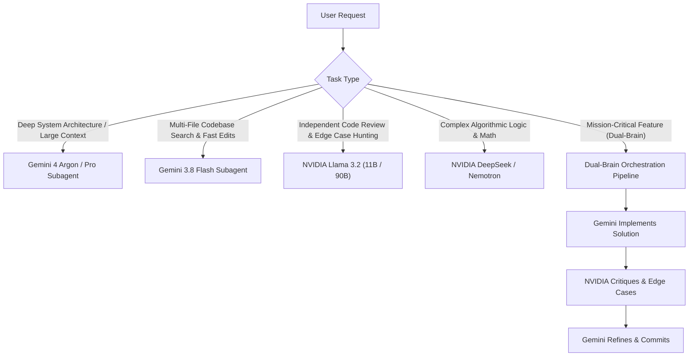

# Multi-Model Orchestration Skill (Gemini + NVIDIA NIM)

This skill provides the reasoning framework and execution protocols for orchestrating tasks across both native Gemini models and NVIDIA NIM models.

---

## 1. Orchestration Philosophy: The Multi-Brain Advantage

When the user asks for a task, do not treat models as interchangeable; leverage their complementary strengths:
* **Gemini (Native Workspace Brain)**: Exceptional long-context comprehension, direct file system/tool integration, fast multimodal indexing, and rapid project-wide edits.
* **NVIDIA NIM (Specialized / Independent Brain)**: Unbiased second-opinion reviews, distinct training distribution (Llama / Nemotron / DeepSeek), specialized code scrutiny, and dual-perspective verification.

---

## 2. Dynamic Model Selection Matrix



### When to Route Where:
1. **Gemini Native**:
   - Tasks requiring workspace tools (editing files, executing tests, terminal commands).
   - Reading multiple large files or entire directory trees (>50k tokens).
   - Fast, interactive code iteration.
2. **NVIDIA NIM**:
   - **Code Review & Security Auditing**: Passing written code to `meta/llama-3.2-11b-vision-instruct` or `90b` to detect blind spots, logical errors, and edge cases.
   - **Second Opinion**: When there are multiple architectural paths and we want diverse perspectives.
   - **Independent Verification**: Confirming algorithms, regexes, SQL queries, or unit tests.

---

## 3. Subagent Creation & Invocation Protocols

### Pattern A: Defining an NVIDIA-Powered Subagent
To delegate specialized analysis to a subagent that communicates with NVIDIA NIM:

```python
define_subagent(
    Name="nvidia_reviewer",
    Description="Independent code reviewer that leverages NVIDIA NIM models for edge-case detection and code hardening.",
    SystemPrompt=(
        "You are an expert code reviewer powered by NVIDIA NIM intelligence. "
        "Your task is to analyze proposed code changes, check for concurrency issues, "
        "security vulnerabilities, edge cases, and performance bottlenecks. "
        "Use the nvidia-nim MCP server or `nv-chat` tool to consult NVIDIA models when needed."
    ),
    EnableWriteTools=True,
    EnableMCPTools=True,
    EnableSubagentTools=False
)
```

Then invoke it with:
```python
invoke_subagent(
    TypeName="nvidia_reviewer",
    Role="NVIDIA Code Reviewer",
    Prompt="Review the newly generated authentication middleware in file:///path/to/auth.ts and list potential edge cases.",
    Model="flash" # Or pro
)
```

### Pattern B: Direct Tool Consultation (Fast Inline Orchestration)
When you need immediate model consultation without spinning up a full subagent, call the NVIDIA MCP tool or CLI directly:

1. **Via MCP Tool**:
   * Tool: `mcp_nvidia-nim_ask_nvidia` (or `call_mcp_tool`)
   * Parameters:
     * `prompt`: The specific question or code snippet to analyze.
     * `model`: `"llama"` (Meta Llama 3.2 11B), `"llama-90b"`, or `"nemotron"`.
     * `system_prompt`: Specific persona instructions.

2. **Via Terminal CLI**:
   ```bash
   nv-chat -m llama "Review this algorithm for memory leaks: [code]"
   ```

---

## 4. Standard Orchestration Workflows

### Workflow 1: The "Dual-Brain" Code Generation (Recommended)
1. **Plan & Draft (Gemini)**: Create the implementation plan and draft the code.
2. **Peer Review (NVIDIA)**: Send the drafted code to NVIDIA Llama 3.2:
   * Prompt: *"Examine this code for edge cases, null pointers, off-by-one errors, and performance bugs. Provide a concise critique."*
3. **Synthesis & Finalization**: Incorporate valid critiques into the final file write.
4. **Report**: Inform the user: *"Kod Gemini ile tasarlandı, NVIDIA Llama 3.2 modeli tarafından incelenip sınır durumlar giderilerek tamamlandı."*

### Workflow 2: Multi-Model Consensus (Architecture / Bug Triage)
1. Query both Gemini reasoning and NVIDIA NIM (`ask_nvidia`) with identical problem descriptions.
2. Compare where both models agree vs. where they diverge.
3. Present the synthesized consensus solution with the rationale.

---

## 5. Verification Checklist

Before reporting completion to the user:
- [ ] Was the task decomposed logically between Gemini and NVIDIA models?
- [ ] Did the appropriate model handle its designated strength (e.g. Gemini for workspace tools, NVIDIA for independent review/logic)?
- [ ] Are all resulting files tested and free of compilation/runtime errors?
