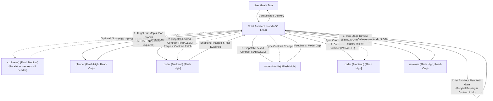

# Orchestrator Synchronization & Communication Protocol (v2.1)

This reference describes how the **Hands-Off Chief Architect** coordinates the **4 Universal Subagents** (`explorer`, `planner`, `coder`, `reviewer`) across the Gemini 3.8 Flash Multi-Agent System.

---

## 1. Hub-and-Spoke Communication Architecture

The Chief Architect serves as the central intelligence hub and message bus. Subagents never form nested matryoshka chains; they report directly to the Chief Architect:



---

## 2. Agent Registry Management

When launching subagents, the Chief Architect maintains a registry tracking conversation IDs for active roles:

```python
active_agents = {
    "explorer": "<conversation-id-explorer>",
    "planner": "<conversation-id-planner>",
    "coder_backend": "<conversation-id-coder-backend>",
    "coder_mobile": "<conversation-id-coder-mobile>",
    "coder_frontend": "<conversation-id-coder-frontend>",
    "reviewer": "<conversation-id-reviewer>",
}
```

Inter-agent routing uses:
`send_message(Recipient=active_agents[role_key], Message=content)`

---

## 3. Standardized Message Formats

### A. Contract Dissemination (Chief Architect to Coder Instances)
```markdown
[CHIEF ARCHITECT BROADCAST: LOCKED CONTRACT]
Source: coder (Backend)
Action: API Endpoint & DTO Finalized

Endpoint: POST /api/v1/characters/equip
Request Payload:
{
  "avatarBaseId": 12,
  "slotItems": { "hair": 45, "clothing": 78 }
}

Response Payload (200 OK):
{
  "success": true,
  "activeAvatar": {
    "id": 12,
    "gender": "female",
    "layers": [
      { "itemType": "hair", "layerOrder": 20, "imageUrl": "..." }
    ]
  }
}

Please bind your state and client models to this locked schema.
```

### B. Client Gap / Conflict Feedback (Client Coder to Chief Architect)
```markdown
[CODER ALERT: CONTRACT GAP DETECTED]
From: coder (Mobile)
Target: coder (Backend) via Chief Architect

Gap Description:
- Mobile UI requires `layerOrder` (int) in `EquippedLayerDto` to sort stack layers.
- Currently, the API response omits `layerOrder`.

Action Required:
- Backend Coder: Update `EquippedLayerDto.cs` and re-run tests.
```

### C. Completion Handshake with Verification Evidence
```markdown
[CODER COMPLETION: VERIFICATION EVIDENCE ATTACHED]
Role: coder (Backend)
Verification Output:
- Command: dotnet test MyApp.Api.Tests
- Passed: 466 passed, 0 failed, 0 skipped
- Exit Code: 0
Status: Ready for Reviewer audit.
```

---

## 4. Concurrency vs. Sequentiality Matrix & Anti-Pattern Locks

To eliminate token waste, redundant code searches, and state divergence, strict concurrency boundaries govern transitions:

| Transition / Phase | Concurrency Mode | Architectural Rationale & Rule |
| :--- | :--- | :--- |
| **`explorer` ↔ `planner`** | ⛔ **STRICTLY SEQUENTIAL** | **NEVER invoke `explorer` and `planner` concurrently!** Planner cannot await explorer output, triggers redundant codebase reads (2x token burn), and eliminates Fast Bypass triage. |
| **`planner` ↔ `coder`** | ⛔ **STRICTLY SEQUENTIAL** | **NEVER invoke `coder` before `planner` + Chief Plan Audit Gate complete** (except Fast Bypass `<= 2` files). Coding without locked contracts causes integration breakage. |
| **`coder` ↔ `reviewer`** | ⛔ **STRICTLY SEQUENTIAL** | **NEVER invoke `reviewer` before ALL parallel `coder` streams finish.** Partial code audits yield false positives and redundant re-reviews. |
| **Multi-`explorer`** | ✅ **PARALLEL ALLOWED** | When exploring separate repos or directories (`Backend`, `Mobile`, `Frontend`), multiple `explorer` instances may run in parallel. **All must complete before `planner` is invoked.** |
| **Multi-`coder`** | ✅ **PARALLEL ALLOWED** | Layer-based `coder` instances (`Coder (Backend)`, `Coder (Mobile)`, `Coder (Frontend)`) execute concurrently strictly AFTER Chief Plan Audit Gate and user confirmation. |

### Decision Flow (`explorer` -> Chief Triage -> `planner`)
1. **Scope Already Clear**:
   - If target files and impacted areas are explicit in the prompt/context, skip `explorer`.
   - If `<= 2` files and no contract change -> Route directly to **Fast Bypass** (1 `coder`).
   - If `> 2` files or cross-cutting -> Route directly to `planner`.
2. **Scope Unclear**:
   - Invoke `explorer` (or parallel multi-`explorer`).
   - Chief waits for all explorers to complete, then executes the **Triage Gate**:
     * `<= 2` files & 0 contract changes -> Skip `planner` entirely, dispatch directly to 1 `coder` (**Fast Bypass**).
     * `> 2` files or multi-layer -> Chief passes the explicit file list and caller map from `explorer` directly into `planner` (`planner` never blind-searches; directly reads target files).

---

## 5. Conflict Resolution & Deadlock Prevention

1. **Chief Architect Governs Contract Parity**: If client and backend implementations diverge, the Chief Architect's audited blueprint governs.
2. **Infinite Chain Immunity**: `coder`, `planner`, and `reviewer` do NOT have `invoke_subagent` tools enabled. All branching is controlled exclusively by the Chief Architect.
3. **Reactive Wakeup**: The Chief Architect never polls. Incoming messages from subagents trigger immediate resumption to route updates.

